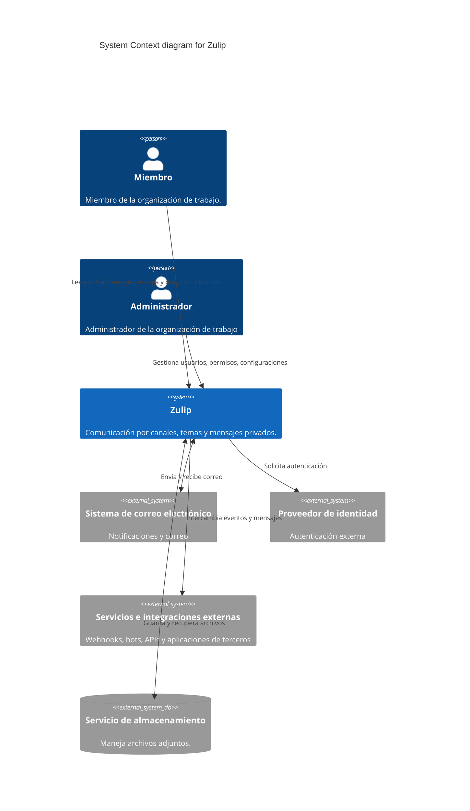
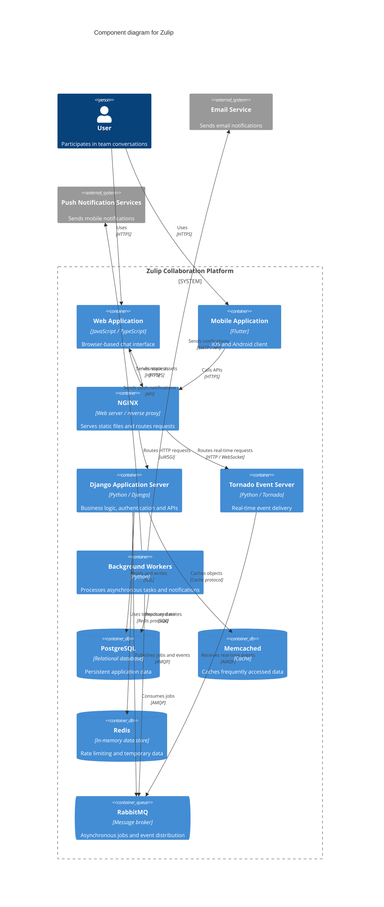

# Diagrama de contexto — C4 nivel 1

El diagrama representa a Zulip, sus usuarios y los servicios externos
que pueden participar según la configuración del despliegue.
Los servicios externos no forman parte de las mejoras propuestas.

# Diagrama de componentes — C4 nivel 2

El diagrama representa los componentes que forman parte de Zulip. La cual hace referencia a lo expuesto en [su documentación](https://zulip.readthedocs.io/en/latest/overview/architecture-overview.html#components)

